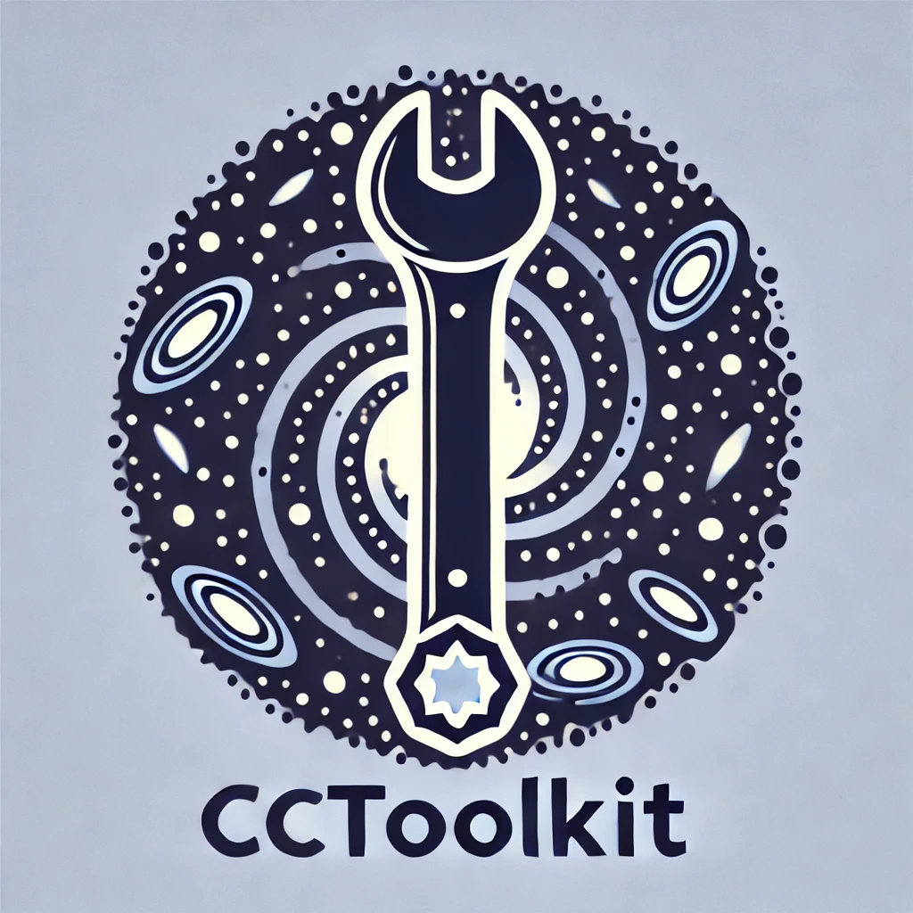

# CCToolkit



[](https://github.com/TiagoBsCastro/CCToolkit/actions)
[](https://doi.org/10.5281/zenodo.13479345)
[](https://cctoolkit.readthedocs.io/en/latest/?badge=latest)
[](https://opensource.org/licenses/MIT)
[](https://github.com/TiagoBsCastro/CCToolkit/commits/main)

<div align="justify">

CCToolkit is a Python package designed for Cluster Cosmology calculations. It handles cosmological parameters, power spectrum computations, halo mass functions, and halo bias and integrates with the CAMB library to deliver precise cosmological data processing.

## Table of Contents
- [Features](#features)
- [Installation](#installation)
- [Usage](#usage)
- [Examples](#examples)
- [Documentation](#documentation)
- [Contributing](#contributing)
- [License](#license)
- [Acknowledgements](#acknowledgements)

## Features

- **Cosmological Calculations**: Easily compute various cosmological quantities, including background quantities and power spectra.
- **Halo Mass Function (HMF)**: Implements the multiplicity function and HMF parameters for different halo finders based on the model presented in [Castro et al. 2023](https://inspirehep.net/literature/2132031) or the model presented in [Castro et al. 2025](https://inspirehep.net/literature/2910564) for dynamical dark energy cosmologies.
- **Halo Bias**: Implements the functions to compute the linear halo bias, with corrections based on the Peak Background Split (PBS) model presented in [Castro et al. 2024b](https://inspirehep.net/literature/2824892).
- **Nonlinear halo bias**: Implements the DUCA III model (Castro 2026) of the scale-dependent halo-matter bias $b_{\rm hm}(k)$ and the halo auto power spectrum $P_{\rm hh}(k)$, including stochasticity, in $w_0w_a$CDM cosmologies with massive neutrinos, for $z < 2.5$ and up to $k \simeq 1$-$2\,h\,{\rm Mpc}^{-1}$.
- **Baryonic impact**: Implements the model presented in [Castro et al. 2024a](https://inspirehep.net/literature/2718844) for the baryonic impact on cluster and group masses.
- **Utility Functions**: Provides useful utilities for manipulating the power spectrum.

## Installation

To install CCToolkit clone the repository and use pip:

```bash
git clone https://github.com/TiagoBsCastro/CCToolkit.git
cd CCToolkit
python -m pip install .
```

### Dependencies

- Python 3.9+
- NumPy
- SciPy
- CAMB

## Usage

To use CCToolkit, start by importing the necessary modules and initializing the `CosmologyCalculator` with your desired cosmological parameters:

```python
from cctoolkit import CosmologyCalculator

# Define cosmological parameters
params = {
    'H0': 70.0,                # Hubble parameter at z=0 in km/s/Mpc
    'Ob0': 0.05,               # Baryon density parameter
    'Om0': 0.3,                # Total matter density parameter (Ob0 + Om_c0)
    'sigma8': 0.8,             # rms density fluctuation amplitude at 8 h^-1 Mpc
    'ns': 0.96,                # Scalar spectral index
    'TCMB': 2.7255,            # CMB Temperature at z=0 in K
    'mnu': 0.06,               # Sum of neutrino masses (eV)
    'num_massive_neutrinos': 1 # Number of massive neutrinos species
}

# Initialize the calculator
cosmo_calc = CosmologyCalculator(params)
```

## Examples

### Halo Mass Function

Calculate the halo mass function for a range of masses following [Castro et al. 2023](https://inspirehep.net/literature/2132031):

```python
import numpy as np
import matplotlib.pyplot as plt

masses = np.logspace(13, 15.5, num=100)
hmf = cosmo_calc.dndlnM(masses, 0)
plt.loglog(masses, hmf)
plt.xlabel(r"$M_{\rm vir}\,[M_\odot h^{-1}]$")
plt.ylabel(r"$\frac{{\rm d} n}{{\rm d} \log M}\,[{\rm Mpc}^{-3} h^{3}]$")
plt.show()
```

Alternatively, using following the model [Castro et al. 2025](https://inspirehep.net/literature/2910564) for dynamical dark energy:

```python
import numpy as np
import matplotlib.pyplot as plt

masses = np.logspace(13, 15.5, num=100)
hmf = cosmo_calc.dndlnM(masses, 0, model='castro25')
plt.loglog(masses, hmf)
plt.xlabel(r"$M_{\rm vir}\,[M_\odot h^{-1}]$")
plt.ylabel(r"$\frac{{\rm d} n}{{\rm d} \log M}\,[{\rm Mpc}^{-3} h^{3}]$")
plt.show()
```

### Halo Bias

CCToolkit can compute both the PBS prescription as well as the corrected model following [Castro et al. 2024b](https://inspirehep.net/literature/2824892).

```python
pbs = cosmo_calc.pbs_bias(masses, 0)
bias = cosmo_calc.bias(masses, 0)

plt.loglog(masses, pbs, label=r'${\rm PBS}$')
plt.loglog(masses, bias, label=r'${\rm Castro\, et\,al.\,2024}$')
plt.xlabel(r"$M_{\rm vir}\,[M_\odot h^{-1}]$")
plt.ylabel(r"$b(M)$")
plt.legend()
plt.show()
```

### Nonlinear Halo Bias

CCToolkit implements the DUCA III model (Castro 2026) of the nonlinear halo-matter bias $b_{\rm hm}(k) = P_{\rm hm}(k)/P_{\rm mm}(k)$ and of the halo auto power spectrum $P_{\rm hh}(k)$, calibrated on the DUCA simulations of [Castro et al. 2025](https://inspirehep.net/literature/2910564) for $z < 2.5$. On large scales $b_{\rm hm} \to b_1$, the linear bias of [Castro et al. 2024b](https://inspirehep.net/literature/2824892) recalibrated on the same simulations. All spectra refer to the cold matter (CDM plus baryons), the default `var='cdm+b'` of the calculator.

Up to $k = 0.4\,h\,{\rm Mpc}^{-1}$ the cross bias needs only the cosmology. The auto spectrum, and the cross bias on smaller scales, also need the nonlinear cold-matter power spectrum $P_{\rm mm}(k)$, for instance from an emulator or, as below, from CAMB:

```python
import numpy as np
import matplotlib.pyplot as plt
import camb
from cctoolkit import CosmologyCalculator

params = {'H0': 67.0, 'Ob0': 0.049, 'Om0': 0.315, 'As': 2.1e-9, 'ns': 0.965,
          'mnu': 0.06, 'num_massive_neutrinos': 1, 'w0': -0.9, 'wa': -0.3}
cosmo_calc = CosmologyCalculator(params, zmax=2.5)
z = 0.5
k = np.geomspace(1e-3, 1.5, 300)

# Cross bias of halos of given masses on large scales: shape (n_mass, n_k)
masses = np.array([2e12, 1e13, 1e14, 1e15])
b_hm, _ = cosmo_calc.nonlinear_bias(k[k <= 0.4], masses, z)

# Nonlinear cold-matter (no neutrinos) power spectrum, here from CAMB's HMcode
h = params['H0'] / 100
pars = camb.set_params(H0=params['H0'], ombh2=params['Ob0'] * h**2,
                       omch2=(params['Om0'] - params['Ob0']) * h**2, mnu=params['mnu'],
                       num_massive_neutrinos=1, w=params['w0'], wa=params['wa'],
                       dark_energy_model='ppf', As=params['As'], ns=params['ns'],
                       redshifts=[z], kmax=10, NonLinear=camb.model.NonLinear_both)
P_nl = camb.get_results(pars).get_matter_power_interpolator(
    nonlinear=True, var1='delta_nonu', var2='delta_nonu', hubble_units=True, k_hunit=True)
P_mm = P_nl.P(z, k)

# Halos in narrow mass bins (as in the calibration): b_hm and P_hh, shape (n_bins, n_k).
# The number density of each bin follows from the Castro et al. 2025 mass function.
edges = np.exp(np.arange(np.log(2e12), np.log(2e15), 0.2))
b_hm, P_hh = cosmo_calc.nonlinear_bias(k, edges, z, matter_power=P_mm, bins=True)

fig, (ax1, ax2) = plt.subplots(1, 2, figsize=(10, 4))
for i in range(0, len(edges) - 1, 10):
    ax1.semilogx(k, b_hm[i])
    ax2.loglog(k, P_hh[i])
ax1.set_xlabel(r"$k\,[h\,{\rm Mpc}^{-1}]$")
ax1.set_ylabel(r"$b_{\rm hm}(k)$")
ax2.set_xlabel(r"$k\,[h\,{\rm Mpc}^{-1}]$")
ax2.set_ylabel(r"$P_{\rm hh}(k)\,[h^{-3}\,{\rm Mpc}^3]$")
plt.show()
```

Pass `number_density` to use the abundance of your own halo sample, and `return_variables=True` to get the halo and cosmology descriptors used by the model. `NonlinearHaloBias` evaluates the model directly on these descriptors.

The model describes a halo sample by one set of properties, and it is calibrated on bins of width $\Delta\ln M = 0.2$. A wider bin is therefore never evaluated at a single mass: `nonlinear_bias` splits it into sub-bins of at most that width and averages their $b_{\rm hm}$ with number-density weights, which is exact for $P_{\rm hm}$. The auto spectrum of a wide bin would also need the cross spectra between its sub-bins, so $P_{\rm hh}$ is only returned for bins of at most $\Delta\ln M = 0.2$. In these bins the halo shot noise dominates $P_{\rm hh}$ at $k \gtrsim 0.3\,h\,{\rm Mpc}^{-1}$; for much denser samples (for instance a `number_density` far above the mass-function value), $P_{\rm hh}$ on small scales is an extrapolation. Between 0.4 and $0.6\,h\,{\rm Mpc}^{-1}$ the large-scale model is joined to its small-scale extension; validate the join before transforming the predictions to configuration space.

### Baryonic Impact

CCToolkit can compute the equivalent dark-matter-only halo mass of a hydrodynamical simulated group or cluster in two simple steps following the model of [Castro et al. 2024a](https://inspirehep.net/literature/2718844):

```python
import cctoolkit
from cctoolkit import baryons
from cctoolkit.cosmology import CosmologyCalculator
z = 0.0
# Magneticum cosmology
params = {"Om0": 0.272, "Ob0": 0.272 * 0.168, "H0": 70.4, "ns": 0.963, "mnu":0, "num_massive_neutrinos": 0, "sigma8": 0.809}
cosmo_calc = CosmologyCalculator()
# Array of virial masses on hydro
M = np.geomspace(1e13, 3e14)
# Calculating the equivalent DMO mass at the threshold of equivalence according to the quasi-adiabatic model
M_Delta_dmo, Delta = baryons.compute_dmo_mass(M, z, 0.168)
Delta *= cctoolkit.utils.virial_Delta(cosmo_calc.Omega_m(z))
# Converting to the virial mass
mdmo = [baryons.compute_rec_mass(cosmo_calc, m, d, z) for m, d in zip(M_Delta_dmo, Delta)]
```

## Documentation

Please visit [CCToolkit Documentation](https://cctoolkit.readthedocs.io) for detailed documentation and API reference.

## Contributing

Contributions are welcome! Please see our [Contributing Guidelines](CONTRIBUTING.md) for details on how to contribute to this project. You can report issues, suggest features, or submit pull requests.

## License

This project is licensed under the MIT License. See the [LICENSE](LICENSE) file for more information.

## Acknowledgements

This package relies on the CAMB library for cosmological calculations. We also acknowledge the authors of the various halo finder software used to produce the best-fit parameters implemented in this package.

</div>
